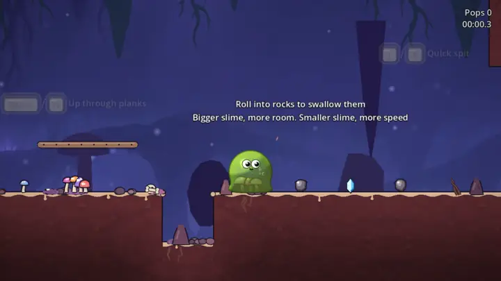
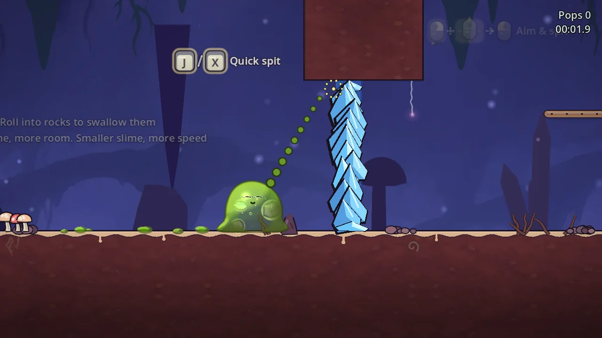
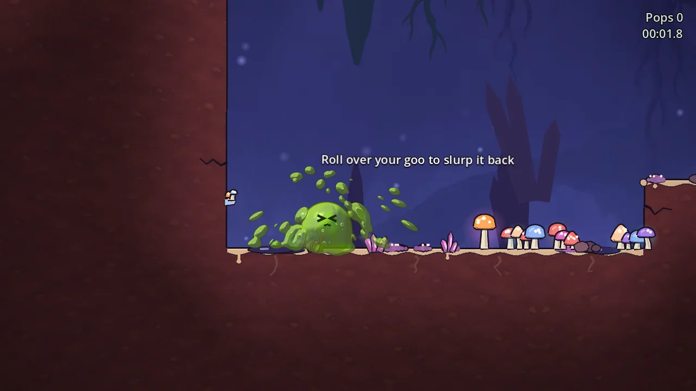
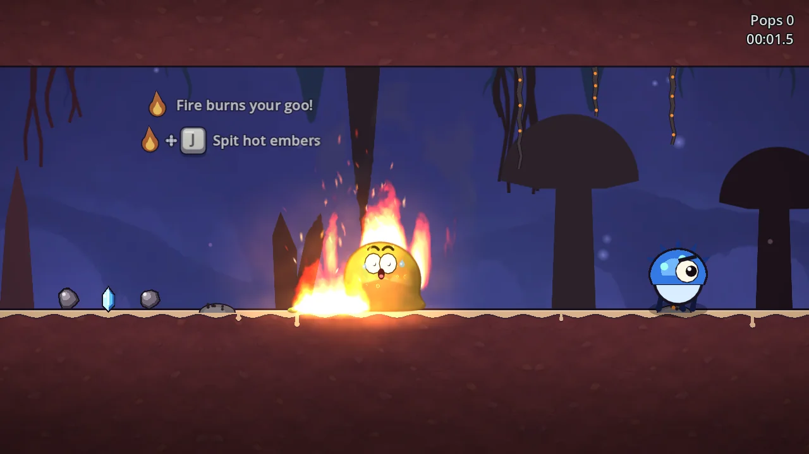
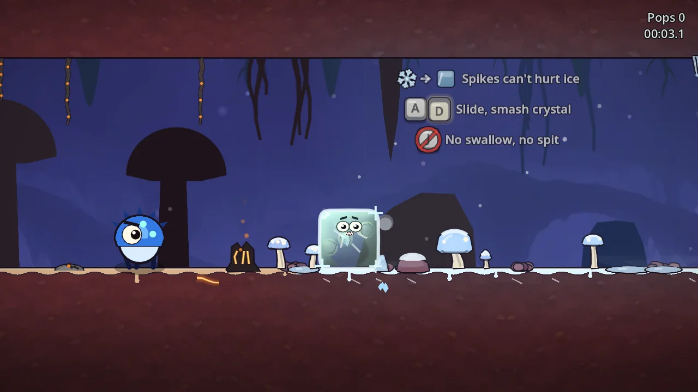
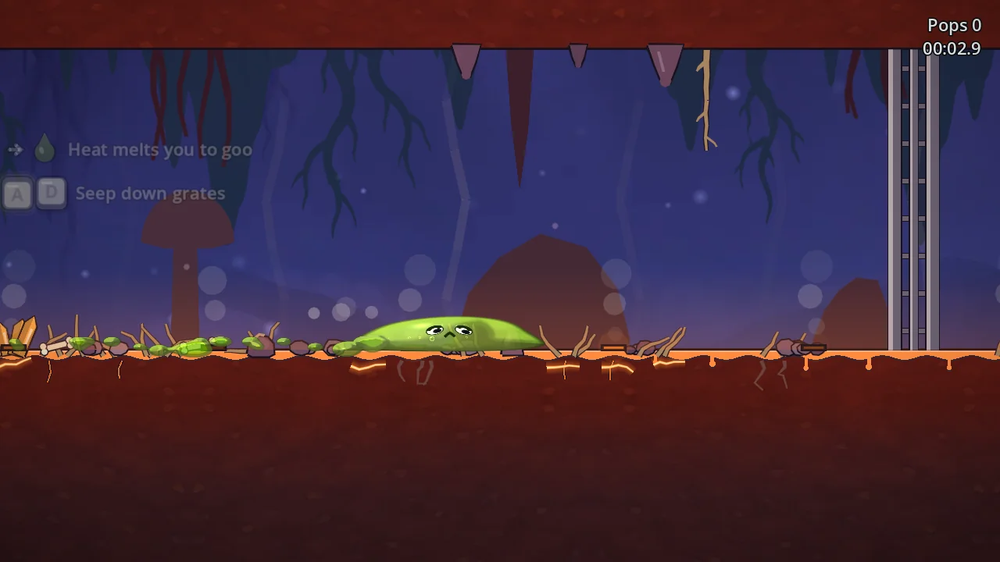
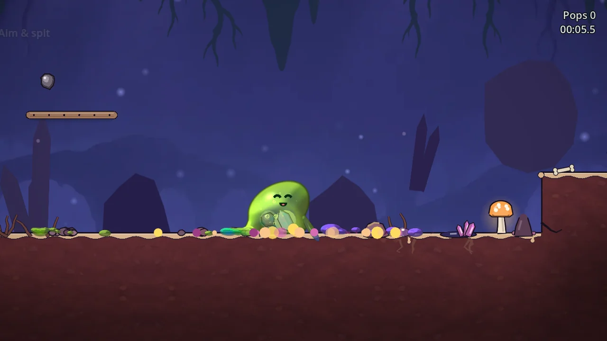

# Slime Prototype

> A 2D platformer made with Godot 4.7, where you are a gooey slime and the mass of your body is your life.



## The game

- You are a green slime made of goo.
- There is no life bar. The size of the slime is its life.
- Damage and high falls splash goo off the body, and the slime gets smaller.
- Lost goo stays on the ground. Move near it, and the slime pulls it back like a magnet.
- Below a minimum size, the slime dies.
- Swallow rocks and crystals, then spit them as shots that ricochet.
- Walk through hot, fire and cold zones that change how the body works.

## Gallery

| | |
|---|---|
|  |  |
| Aim mode shows the trajectory. Swallowed rocks float inside the translucent body. | A high fall splashes goo around the slime. |
|  |  |
| The fire zone sets the slime on fire. | The cold zone freezes the slime into an ice cube. |
|  |  |
| The hot zone melts the slime into a puddle. | A popped monster drops goo of its colour. |

## Features

### Goo and mass

- The mass of the slime is its life.
- Damage and high falls splash goo off the body.
- Lost goo pulls back toward the slime like iron to a magnet.
- A smaller slime is faster and more agile.
- A larger slime has room for more objects.
- Below a minimum mass, the slime dies and starts again at the last checkpoint.

### Moves

- Double jump: one more jump in the air, refilled on the floor and on a wall.
- Run: a faster crawl that drips goo on the ground as a trail. The run costs mass.
- Skid: turn back during a run to slide, flip and launch the other way.
- Dodge and roll: a fast evade on the floor.
- Wall cling and climb: stick to a wall in the air, then wall jump or kick up the same wall.
- Crouch: crawl under low ceilings and drop through one-way planks.

### Objects and shots

- Roll into rocks and crystals to swallow them.
- Swallowed objects float inside the translucent body and wobble with the jelly.
- Spit an object as a quick shot, or hold the aim mode to see the trajectory before you fire.
- Shots ricochet off floors, walls and ceilings.
- Shots break crystal barriers and hurt monsters.
- Traps break a thrown object into smaller pieces.

### Zones

- Hot zone: the slime melts into a puddle, seeps down grates and flows through pipes.
- Fire zone: the slime catches fire, and the fire burns up to half of the full mass.
- A burning slime spits hot ember shots.
- Cold zone: the slime freezes into an ice cube.
- The ice cube slides on ice, smashes crystal and ignores spikes.
- The ice cube cannot swallow objects, shoot or aim.

### Monsters

- Coloured monsters walk the level.
- A popped monster drops goo of its colour.
- Goo of a new colour mixes with the green body colour.

### Input and feedback

- Keyboard and mouse, Xbox pads, PlayStation pads and touch screens.
- The on-screen hints show only the icons of the device in use, and change when you change device.
- Phones and pads vibrate on hits, landings and fire.
- All sound effects are procedural. The game makes them at start, with no audio files.

### Performance

- Three quality levels: Low, Medium and High.
- An automatic mode measures the frame time during play and changes the level to keep the target frame rate.
- An in-game performance panel shows frame, script, draw and render times, draw calls and the device names.

## Controls

| Action | Keyboard and mouse | Xbox or PlayStation pad | Touch |
|---|---|---|---|
| Move | A / D or arrows | Left stick or D-pad | Floating stick |
| Jump and double jump | Space, W, Up or Z | A / Cross | Green button |
| Quick shot | J or X | X / Square | Rock button |
| Aim (hold) | Right mouse button | LT / L2, direction on the right stick | Hold and drag the blue button |
| Fire | Left click | RT / R2 | Release the drag |
| Run | Shift | RB / R1 | Push the stick to its limit |
| Dodge and roll | K or C | B / Circle | Pink button |
| Crouch | S or Down | Stick or D-pad down | Stick down |
| Restart | R | Back / Share | Corner button |
| Performance panel | F3 (F5 quality, F6 render scale) | | Small corner button |
| Fullscreen and quit | F11 and Esc | | Android back |

## Download

Get the builds from the [v0.1.0 release](https://github.com/salvimateus/slime-the-game/releases/tag/v0.1.0).

- Windows: `slime-prototype-0.1.0-windows-x86_64.exe`.
- Android: `slime-prototype-0.1.0-android-arm64-debug.apk` (arm64 phones).

Notes:

- The Windows exe has no code signature. Windows SmartScreen can show a warning. Click **More info**, then **Run anyway**.
- The APK is a debug build that is not from the Play Store. Let your phone install apps from unknown sources before you open it.

## Run from source

1. Install [Godot 4.7.2](https://godotengine.org/download/).
2. Clone this repository.
3. Open `project.godot` in the Godot editor.
4. Press **F5** to play.

The project uses the Compatibility renderer (OpenGL) on desktop and on mobile.

## Export

The project has two export presets:

- `Android`: arm64, signed with the debug keystore of the editor.
- `Windows Desktop`: x86_64, with the PCK embedded in the exe.

The `Windows Desktop` preset points to a custom release template on the machine of the author. Clear the **Custom Template > Release** field to use the official export template.

## Project structure

- `autoload/`: global singletons: game state and input map, tuning values, quality, sound, haptics, touch controls, performance panel and the test harness.
- `scenes/`: scenes and their scripts for the player, the goo, the level objects, the props and the UI.
- `scripts/`: shared code for the camera, fire, effects, goo, level build and decoration, props and UI.
- `art/textures/`: background and ground textures.
- `images-codex/`: source images of the textures (not imported by Godot).
- `docs/screenshots/`: the images of this README.
- `PRIMITIVES.md`: the inventory of the shared contracts of the code.

## Test harness

The `Harness` autoload reads the arguments after `--` for scripted runs. A scripted run does not read or write the user settings.

Useful arguments:

- `--spawn=<marker>` or `--spawn=<column>,<row>`: start at a level marker or a tile.
- `--input-inline="<tick> <action>;..."`: play scripted input at fixed physics ticks.
- `--log=stdout`: print the game events as JSON lines.
- `--quit-at-tick=<n>`: quit after n physics ticks.
- `--shot=<file.png> --frames=<n>`: save a screenshot after n frames.
- `--shots=<folder> --at=<f1>,<f2>`: save several screenshots in one run.
- `--freeze-at=<seconds>`: freeze the game time at that moment for a screenshot.
- `--mass=<n>`: start with a different mass.
- `--props="<kind>@<column>,<row>;..."`: add props to the level.
- `--temp=<-1..1>`: start frozen (-1) or melted (1).
- `--burn`: start on fire.
- `--perf`: log the slow frames.

Examples (headless, log only):

```bash
# walk and jump
godot --headless --path . --fixed-fps 60 -- --spawn=start --input-inline="22 right+;71 jump:20;141 right-" --log=stdout --quit-at-tick=281

# swallow three props
godot --headless --path . --fixed-fps 60 -- --spawn=props --input-inline="22 right+;100 right-" --log=stdout --log-every=0 --quit-at-tick=160

# walk through every temperature zone
godot --headless --path . --fixed-fps 60 -- --spawn=heat --input-inline="22 right+;505 shoot" --log=stdout --log-every=30 --quit-at-tick=1300
```

Example (windowed screenshot of the aim preview):

```bash
godot --path . --fixed-fps 60 --audio-driver Dummy --resolution 1280x720 -- --spawn=props --input-inline="22 right+;100 right-;102 aim+;103 stick=-62,0.7" --freeze-at=1.95 --shot="/absolute/path/aim.png" --frames=240
```

## Performance panel and quality levels

- Press **F3** (or the small corner button on touch) to open the performance panel.
- The panel shows frame, script, draw and render times, draw calls, primitives and the device and GPU names.
- The number keys turn the costly systems on and off, to measure each one.
- **F5** changes the quality mode: Auto, Low, Medium or High.
- **F6** changes the render scale: Auto, Full or Base.
- In the Auto mode, the game goes one step down when it cannot hold the target frame rate, and tries one step up after a long calm time.
- The game saves the quality mode and the panel switches on the device.

## Status

- This is a prototype.
- It has one level, from the start cave to the goal after the cold room.
- Expect rough edges and changes.
